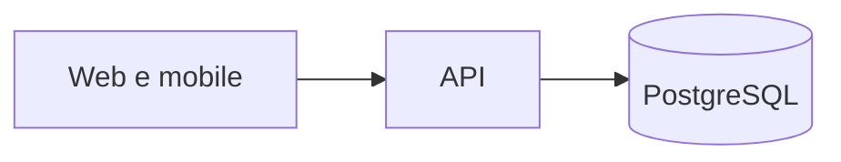

# Papufy

Estudo de caso público. O código do produto é proprietário e não está neste repositório.

Marketplace B2C de serviços locais, no ar em [papufy.com](https://papufy.com/). A pessoa busca por categoria e cidade, publica um pedido de serviço ou um perfil profissional, conversa no chat e acompanha publicações, notificações e carteira. Web e mobile no mesmo produto.

## O que eu fiz

Trabalhei no produto em produção, da interface até o fluxo que a API sustenta.

- Interface mobile-first em React, TypeScript, Vite e Tailwind
- Busca, categorias, anúncio, autenticação, chat, notificações e carteira
- Catálogo, busca e anúncios apoiados por API e PostgreSQL

## Arquitetura

| Parte | Responsabilidade |
| --- | --- |
| Web e mobile | Busca, anúncio, chat, notificações, perfil e carteira |
| API | Catálogo, busca e fluxos de anúncio |
| PostgreSQL | Dados do marketplace |

## Stack

React, TypeScript, Node.js, PostgreSQL.

## Por que não há código aqui

O Papufy é um produto em operação. Este repositório existe para mostrar o escopo do trabalho a quem avalia experiência, sem entregar a implementação para cópia.
